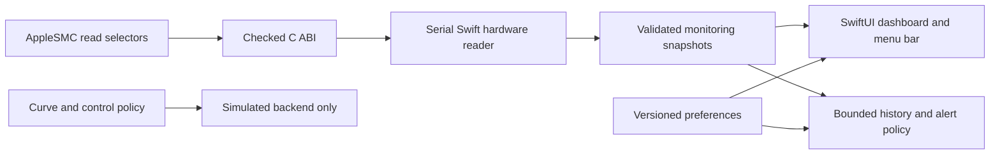

# Architecture

ThermalCore defines snapshots, readings, freshness, trust, history, configuration, alert policy and curve arithmetic. HardwareAccess serializes hardware access and owns connection lifetime. The presentation owns sampling demand, UI state and notifications on the main actor. Sensor and control evidence are distinct. The app has no privileged service or hardware-write path.

Dates support presentation and history. Use a monotonic clock for sampling deadlines and simulated lease expiry. Resample after sleep and reject expired telemetry before presenting or using it. Bound sample count independently of retention duration.

Potential XPC control is a separate future design. See the ADRs and hardware research for constraints.

The test-only ControlSimulation module models authorization, trusted inputs, leases, bounded targets and restoration. See [fan control feasibility](../safety/fan-control.md) for the state diagram and release gate.
