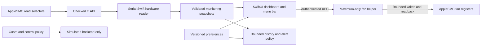

# Architecture

ThermalCore defines snapshots, readings, freshness, trust, history, configuration, alert policy and curve arithmetic. HardwareAccess serializes hardware access and owns connection lifetime. The presentation owns sampling demand, UI state and notifications on the main actor. Monitoring uses an unprivileged AppleSMC connection. The helper accepts three commands over authenticated XPC and limits its writes to maximum-speed control and restoration on the supported Mac.

Dates support presentation and history. Use a monotonic clock for sampling deadlines and simulated lease expiry. Resample after sleep and reject expired telemetry before presenting or using it. Bound sample count independently of retention duration.

The in-memory ControlSimulation module models authorization, trusted inputs, leases, bounded targets and restoration in tests and explicit Demo sessions. It never connects to hardware. See [fan control feasibility](../safety/fan-control.md) for the state diagram and release gate.
