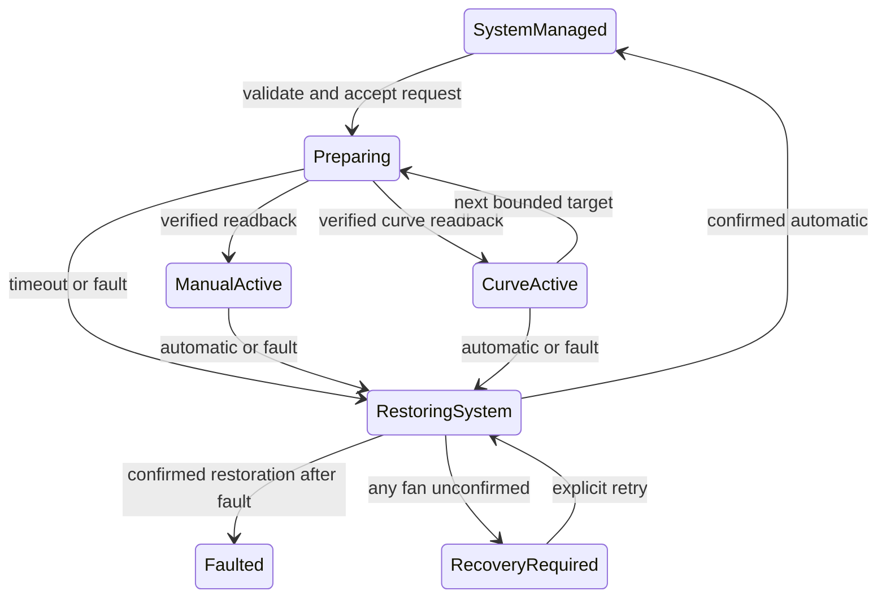

# Fan control feasibility and recovery

## Device decision

The maximum-only helper was physically verified on Mac16,7 with Apple M4 Pro and macOS 26.6.2 build 25G83. An administrator can install it from an ad hoc local build. Custom curves remain in Demo pending validation of control-grade sensors and a system cooling floor. Crash recovery is deferred. Behavior after abrupt helper termination is unknown.

The installed Macs Fan Control 1.5.21 app and its root-owned fan-write helper are present. CrystalIDEA reports that M3/M4 MacBook Pro control returned in 1.5.18 and that normal Quit returns all fans to Auto. The vendor does not publish the helper's write or restoration contract, and its [documented command line](https://crystalidea.com/macs-fan-control/command-line) does not expose fan control. [Release notes](https://crystalidea.com/macs-fan-control/release-notes) · [Normal Quit behavior](https://crystalidea.com/macs-fan-control)

Open-source M4 research describes `Ftst` as a force/test flag in the system management controller. Setting it makes macOS's thermal manager yield fan control; clearing it lets macOS reclaim the fans. Implementations also release the per-fan manual settings they own. The handoff should be verified using the flag, both mode readings and measured RPM as the fans settle. A successful write alone does not establish that the fans are back under system control. [M4 SMC research](https://github.com/agoodkind/macos-smc-fan/blob/31a1feae0c4999ebd8cdddfbd90d2c98182091b8/docs/research.md#key-findings) · [MacFanControl ownership and restoration](https://github.com/raminsharifi/MacFanControl#safety-design)

The read-only probe on this Mac returned `F0Md = 3`, `F1Md = 3`, and `Ftst = 0`. Lowercase mode keys were absent. Raising a fan's minimum would let the system keep choosing the actual speed on hardware that supports it. On this Mac, the metadata for both minimum keys is `0x84`, without the known write bit (`0x40`); the mode and force/test keys returned `0xd0`. Metadata alone cannot prove that any write will be accepted. [Minimum speed behavior on another M4 model](https://github.com/beomwookang/macos-fan-control#what-the-smc-fan-keys-actually-do)

The installer requires a local administrator to authorize the system daemon. The recorded hardware checks used only reads.

The previous helper timed out after four seconds of rejected mode writes while the first fan still reported mode 0 and a target of 1,350 RPM. A reference run with Macs Fan Control on the same Mac showed both fans in mode 0 at low speed for about eight seconds before both switched to mode 1 with targets of 5,777 RPM. Both measured speeds came within 250 RPM of the target about three seconds later. The updated helper uses a shared 18-second deadline for mode and target readback, followed by a separate 12-second deadline for measured speed. The older helper's rollback and the reference app's normal Quit both returned `Ftst` to 0 and both fan modes to 3.

## State and restoration

The deterministic in-memory plant is driven with virtual monotonic time. Control starts only with an explicitly validated simulation, a complete fresh trusted input set, confirmed authority, and valid fan bounds. The simulated system demand is a floor for every target. Firmware limits alone would be insufficient.

The simulated supervisor stops sending targets after stale, missing, invalid or future-dated inputs, read or write errors, mode/target divergence, changing capabilities, authority loss, or a missed lease deadline. It restores all owned fans and verifies readback. A competing controller's fan is reported as unconfirmed. A switch while settling triggers restoration and requires a fresh request. Wake never replays the previous profile.

The simulator can apply one percentage curve to exactly two fans, converting each point using that fan's reported maximum. The curve editor's 0% endpoint represents 0 RPM. The simulator still requires each resulting target to meet the model's minimum and the current system cooling demand. In explicit Demo mode, Max Fans temporarily selects each fan's maximum. Turning it off restores the prior mode; if a prior curve is no longer safe, it falls back to Automatic. Normal Quit clears the override and selects Automatic directly.

## Live helper

The local installer puts the helper and its identity file under `/Library/PrivilegedHelperTools` and registers it as a system launch daemon. Both endpoints authenticate the peer's identifier and exact code signature hash over XPC. The identity file is owned by root and ties authorization to one app and helper build. Reinstall after a rebuild changes the app's hash. Distribution builds use [SMAppService](https://developer.apple.com/documentation/servicemanagement/smappservice) with matching signing teams.

The daemon also checks the current console user and associates an override with one connection. Its interface accepts status, maximum and automatic. It derives the two RPM values from hardware and accepts neither keys nor RPM values from the app.

The helper starts from two fans in system mode with the override clear. It verifies both fans' targets and measured RPM before confirming Maximum. During an override, it checks readback and macOS thermal pressure once a second. Failed activation, lost readback, high thermal pressure and client disconnect request restoration. On normal Quit, the app waits for both fans in system mode with the override clear. If that check fails, Quit is canceled and the user can retry. The app does not persist overrides.

## Physical verification

The installed helper from commit `5e58989` reached Maximum with dashboard readings of 5,777 and 5,780 RPM. Restore Automatic returned both fans to 0 RPM at idle. A second run reached Maximum and the app quit normally. A separate SMC read after Quit confirmed `Ftst = 0`, both modes at `3`, and both targets and measured speeds at 0 RPM. Physical sleep and wake while an override is active still need verification. The in-memory tests cover failed spin-up, partial writes, high thermal pressure and a failed restore followed by a retry.

Manual cooling can alter normal thermal behavior and may contribute to higher temperatures, instability, hardware damage or data loss. ThermalDeck uses undocumented read interfaces and is provided as is under the MIT license. Use is at your own risk. ThermalDeck has no affiliation with Apple.
