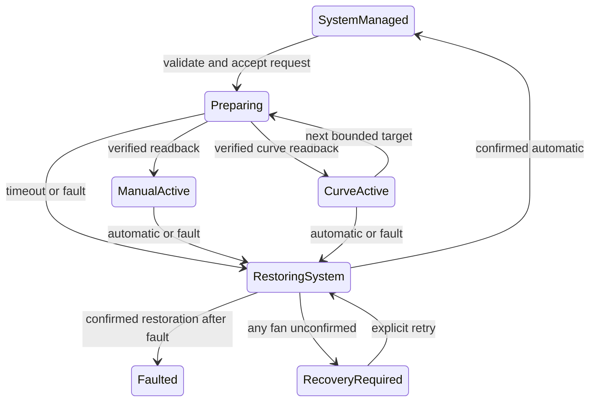

# Fan control feasibility and recovery

## Device decision

Manual and curve control remain disabled on Mac16,7/M4 Pro with macOS 26.6.2. The physical read-only probe confirms two fans in firmware mode 3. The reference M4 procedure uses an undocumented diagnostic override that can inhibit the normal thermal manager. The write path, normal-quit restoration from an active override, and control-grade sensing remain unverified. Independent crash recovery is deferred at the owner's request. Behavior after an abrupt exit is unknown.

The follow-up comparison used the installed Macs Fan Control window as a second RPM display while the system controlled the fans. Read-only SMC checks on the same Mac returned `F0Md = 3`, `F1Md = 3`, and `Ftst = 0`. The lowercase mode keys were absent. The vendor reports M3/M4 control support without publishing the write and restoration contract. [Macs Fan Control implementation discussion](https://github.com/crystalidea/macs-fan-control/issues/822) · [SMC research](https://github.com/agoodkind/macos-smc-fan/blob/31a1feae0c4999ebd8cdddfbd90d2c98182091b8/docs/research.md)

No real write test is proposed while those prerequisites are open. ThermalDeck has no write selector, service, privilege escalation, or diagnostic override. The vendor's [documented command line](https://crystalidea.com/macs-fan-control/command-line) does not expose a fan control command. No real fan command or thermal stress was performed.

## State and restoration

The deterministic in-memory plant is driven with virtual monotonic time. Control starts only with an explicitly validated simulation, a complete fresh trusted input set, confirmed authority, and valid fan bounds. The simulated system demand is a floor for every target. Firmware limits alone would be insufficient.

The simulated supervisor stops sending targets after stale, missing, invalid or future-dated inputs, read or write errors, mode/target divergence, changing capabilities, authority loss, or a missed lease deadline. It restores all owned fans and verifies readback. A competing controller's fan is reported as unconfirmed. A switch while settling triggers restoration and requires a fresh request. Wake never replays the previous profile.

The simulator can apply one percentage curve to exactly two fans, converting each point using that fan's reported maximum. The curve editor's 0% endpoint represents 0 RPM. The simulator still requires each resulting target to meet the model's minimum and the current system cooling demand. In explicit Demo mode, Max Fans temporarily selects each fan's maximum. Turning it off restores the prior mode; if a prior curve is no longer safe, it falls back to Automatic. Normal Quit clears the override and selects Automatic directly.

## Prospective privilege and threat model

If a defensible pathway emerges, evaluate an embedded, minimally privileged daemon registered through SMAppService with an XPC listener. Validate a designated requirement that pins the intended signing team and app identifier against the connection. Missing or invalid signing identity fails closed. Audit identity, session ownership and authorization must be independent checks. Treat every message as untrusted. Keep the command surface to typed, bounded operations against fixed compatible fans. Reject arbitrary keys, arbitrary filesystem paths, untrusted executables, unknown enum cases, stale requests and concurrent owners.

A daemon must enforce trusted sensor reads, bounds, command rate limits, and verification. On normal Quit, restore each fan ThermalDeck owns and confirm system mode before terminating. Revoke authority on logout, sleep, shutdown, authorization change, service upgrade/uninstall or competing control. Startup may verify previously unconfirmed state. It must never reapply persisted manual commands. Independent fallback after a crash is a follow-up.

## First hardware write gate

Establish independently reviewed command, encoding, privilege, thermal-floor and normal-quit restoration semantics for the exact model and OS. Complete mock fault coverage and record a bounded test and restoration protocol. Obtain explicit user authorization for that test. Verify both applied mode and measured RPM within a bounded settle interval, then verify return of system mode on Quit. Long-duration testing follows after the bounded test succeeds.

Manual cooling can alter normal thermal behavior and may contribute to higher temperatures, instability, hardware damage or data loss. ThermalDeck uses undocumented read interfaces and is provided as is under the MIT license. Use is at your own risk. ThermalDeck has no affiliation with Apple.
